<p align="center">
  
</p>

<p align="center">
  <a href="./README.md">Español</a> · <b>English</b>
</p>

<p align="center">
  <a href="https://www.linkedin.com/in/ronald-hernandez-g/"></a>
  <a href="mailto:rohernandezg@unal.edu.co"></a>
  <!-- <a href="https://YOUR-PORTFOLIO"></a> -->
  
</p>

---

### `$ whoami`

**Systems Engineering** student at **Universidad Nacional de Colombia (Medellín)** and **Software Development Technologist** from **SENA**. I build software that ends up being used in the real world, and I'm specializing in **data engineering**.

```sql
SELECT interests
FROM   ronald
WHERE  topic IN ('backend', 'databases', 'data pipelines', 'cloud');
```

- My point-of-sale system is **in production** at a real pizzeria.
- I worked as a **bilingual Transport Coordinator** at Exclusive Heavy Haul, coordinating logistics operations in English.
- I was a **speaker** at the Data Science & AI research group *(Aperture Systems)* with an interactive, **detective-themed SQL** talk.
- I presented my research project **EasyParking** at the National and International Meeting of Research Seedbeds (**RedCOLSI**, 2023) and co-authored a paper on it in a SENA journal.
- I'm currently building my first end-to-end data project.

---

### `$ ls ./projects`

#### 🍕 PeñolinniPOS — `in production`
Fullstack point-of-sale system for **Don Peñolinni** pizzeria (Guarne, Colombia). It replaced paper orders, which could get lost or damaged, with **digital orders and invoices synced in real time** between the register and the kitchen.

> **Improved operational efficiency by ~20%.**

`React 19` `Vite` `Tailwind CSS 4` `React Router 7` `Node.js` `Express 5` `Socket.IO` `SQLite`

<!-- Check the repo name -->
[→ View repository](https://github.com/IDKRonald/PenolinniPOS)

#### 🏢 PortónApp — `rolling out`
A **residential community management** platform. It's a layered REST API (routes, services and middleware) with a lightweight, framework-free web frontend.

- Authentication with **JWT + refresh tokens**, **bcrypt** password hashing and cookies.
- Security with **helmet**, **CORS** and **rate limiting**.
- A custom **audit middleware** and HTTP request logging.
- File uploads (avatars) and database init and migration scripts.

`Node.js` `Express 5` `MySQL` `JWT` `HTML` `CSS` `JavaScript`

<!-- Check the repo name -->
[→ View repository](https://github.com/IDKRonald/PortonApp)

#### EasyParking — `research · SENA`
A web platform to **automate and manage parking lots** in Guarne, Colombia, built with Scrum in SENA's Teleinformatics research group.

- **AI license plate capture** and automatic parking-space assignment.
- **Machine learning** models (decision trees with scikit-learn and intelligent agents with TensorFlow) to predict space availability, with **over 85% accuracy**.
- Modules for spaces, customers, employees, vehicles, payments and rates. It logs entries and exits and uses username and password login.

> Presented at the **XXVI National and XX International Meeting of Research Seedbeds (RedCOLSI)**, University of Cartagena, October 2023.
> Published in *Revista Encuentro SENNOVA del Oriente Antioqueño*, 10(1), 5–18 (2024), under the title *Plataforma WEB para la automatización y control integral de parqueaderos Arparking*.

`PHP` `JavaScript` `jQuery` `Python` `scikit-learn` `TensorFlow` `MySQL` `Scrum`

<!-- Add the paper link here -->
[→ Read paper](#)

---

### `$ stack`

<p>
  <br/>
  <br/>
  <br/>
  
</p>

**Learning:** Python for data · data modeling · ETL pipelines · cloud

---

### `$ git log --graph`

<p align="center">
  <picture>
    <source media="(prefers-color-scheme: dark)" srcset="https://raw.githubusercontent.com/IDKRonald/IDKRonald/output/snake-dark.svg" />
    <source media="(prefers-color-scheme: light)" srcset="https://raw.githubusercontent.com/IDKRonald/IDKRonald/output/snake-light.svg" />
    
  </picture>
</p>

---

<p align="center">
  <sub>Open to software development and data opportunities · <a href="https://www.linkedin.com/in/ronald-hernandez-g/">let's talk</a></sub>
</p>
