<p align="center">
  
</p>

<p align="center">
  <b>Español</b> · <a href="./README.en.md">English</a>
</p>

<p align="center">
  <a href="https://www.linkedin.com/in/ronald-hernandez-g/"></a>
  <a href="mailto:rohernandezg@unal.edu.co"></a>
  <!-- <a href="https://TU-PORTAFOLIO"></a> -->
  
</p>

---

### `$ whoami`

Estudiante de **Ingeniería de Sistemas** en la **Universidad Nacional de Colombia (Medellín)** y **tecnólogo en Análisis y Desarrollo de Software** del **SENA**. Construyo software que termina usándose en el mundo real, y me estoy especializando en **ingeniería de datos**.

```sql
SELECT intereses
FROM   ronald
WHERE  tema IN ('backend', 'bases de datos', 'pipelines de datos', 'nube');
```

- 🍕 Mi sistema POS está **en producción** en una pizzería real.
- 🚚 Trabajé como **Transport Coordinator bilingüe** en Exclusive Heavy Haul, coordinando operaciones logísticas en inglés.
- 🎤 Fui **ponente** en el Semillero de Ciencia de Datos e IA *(Aperture Systems)* con una charla interactiva de **SQL al estilo detectives** 🕵️.
- 🔨 Ahora mismo estoy construyendo mi primer proyecto de datos de punta a punta.

---

### `$ ls ./proyectos`

#### 🍕 PeñolinniPOS — `en producción`
Punto de venta fullstack para la pizzería **Don Peñolinni** (Guarne, Antioquia). Reemplazó las comandas en papel, que se perdían o se dañaban, por **comandas y facturas digitales sincronizadas en tiempo real** entre caja y cocina.

> 📈 **Aumentó la eficiencia de la operación en un ~20 %.**

`React 19` `Vite` `Tailwind CSS 4` `React Router 7` `Node.js` `Express 5` `Socket.IO` `SQLite`

<!-- Verifica el nombre del repo -->
[→ Ver repositorio](https://github.com/IDKRonald/PenolinniPOS)

#### 🏢 PortónApp — `en implementación`
Plataforma para la **gestión de unidades residenciales**. Es una API REST por capas (rutas, servicios y middleware) con un frontend web ligero, sin framework.

- Autenticación con **JWT + refresh tokens**, contraseñas con **bcrypt** y cookies.
- Seguridad con **helmet**, **CORS** y **rate limiting**.
- **Middleware de auditoría** propio y registro de peticiones.
- Subida de archivos (avatares) y scripts de inicialización y migración de la base de datos.

`Node.js` `Express 5` `MySQL` `JWT` `HTML` `CSS` `JavaScript`

<!-- Verifica el nombre del repo -->
[→ Ver repositorio](https://github.com/IDKRonald/PortonApp)

---

### `$ stack`

<p>
  <br/>
  <br/>
  
</p>

**Aprendiendo:** Python para datos · modelado de datos · pipelines ETL · nube

---

### `$ git log --stats`

<p align="center">
  
  
</p>

<p align="center">
  
</p>

---

<p align="center">
  <sub>Abierto a oportunidades en desarrollo de software y datos · <a href="https://www.linkedin.com/in/ronald-hernandez-g/">hablemos</a></sub>
</p>
